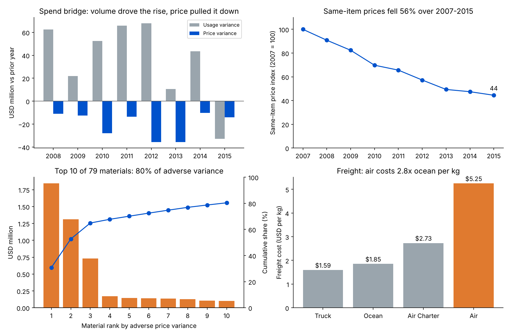

# Material Cost Variance Analytics: Price vs Usage, Top Drivers and Root Causes

A material cost variance dashboard built on real procurement data. It validates the raw upload, splits every year's change in material spend into **price variance** and **usage variance**, ranks the materials behind adverse variances, and traces the root causes to vendors, fulfilment route and freight mode.

**Data:** USAID Supply Chain Management System (SCMS) delivery history, **10,324** purchase lines for **180** materials from **73** vendors, delivered to **43** countries between 2006 and 2015, **USD 1.63B** of spend. The materials are medicines and test kits, but the method applies to any bought-in material, such as pulp, chemicals or packaging.



## Key findings

| Area | Finding | Decision it supports |
|---|---|---|
| Data validation | **10,307 of 10,324** lines pass. 17 lines have zero value and are excluded. Every line's value equals quantity × pack price, and no IDs are duplicated. **4,126** lines have no numeric freight cost: **1,442** have freight included in the material price and **2,445** have it booked on another line. | A governed upload must flag these before the numbers reach a dashboard |
| Spend bridge | Annual spend rose **86%**, from USD 112M (2008) to USD 208M (2015). Over 2008–2015, **usage** added **USD 292M** and **price** saved **USD 161M**. | The cost rise was a volume story, not a price story |
| Price trend | A same-item price index fell from **100** (2007) to **44** (2015), a **56%** drop, and same-item prices fell in every year. | Track price per material over time, not just total spend |
| Top adverse materials | Even with prices falling overall, **79** materials had adverse price variance worth **USD 6.0M**. The top **10** caused **80%** of it and the top **5** caused **70%**, led by an HIV test kit (USD 1.8M). | Root-cause analysis can start with 10 materials, not 79 |
| Vendor price spread | **USD 35.6M** (**2.2%** of spend) was paid above the median price for the same material in the same year. **86%** of it came from materials bought from more than one vendor, and the top 3 vendors account for **73%**. | Consolidate vendors and benchmark prices on multi-vendor materials |
| Fulfilment route | For the same material in the same year (237 cases), buying through the regional distribution centre cost **3.5%** less than a direct drop. | Route repeat materials through the distribution centre |
| Freight | Air freight costs **USD 5.25/kg**, **2.8x** ocean (USD 1.85/kg), and takes **64%** of all freight spend. Freight adds **5.8%** to the value of the goods. | Plan ahead to move non-urgent volume from air to ocean or truck |

## Method

**Validation.** Before analysis, each line is checked for: a valid delivery date, value > 0, quantity > 0, value = quantity × pack price (within 1%), unique ID and a numeric freight cost. Lines failing the first four checks are excluded; the counts are in `results/variance_dashboard.xlsx`, sheet *Validation*.

**Price and usage variance.** For each material i in year t:

- AQ = actual quantity bought in year t (packs)
- AP = actual average price in year t = value ÷ AQ
- SP = standard price = the material's average price in year t − 1
- BQ = baseline quantity = the material's quantity in year t − 1

Then:

- Price variance PV = (AP − SP) × AQ. Positive = adverse (paid more than standard).
- Usage variance UV = (AQ − BQ) × SP. Positive = bought more than the year before.
- For materials bought in both years, PV + UV = AQ × AP − BQ × SP, the full change in their spend.

Materials bought only in year t are shown as *new items*, and those bought only in year t − 1 as *dropped items*. The bridge reconciles exactly: prior-year spend + PV + UV + new items + dropped items = this year's spend (the script asserts this).

**Price index.** Each year's same-item price change = Σ(AP × AQ) ÷ Σ(SP × AQ) − 1 over materials bought in both years; the index chains these changes from 2007 = 100.

**Vendor price spread.** For each line, spend above median = max(0, pack price − median pack price for that material and year) × quantity, where the median is taken over all lines of that material in that year.

**Freight.** Freight per kg = Σ freight cost ÷ Σ weight, by shipment mode, using only lines with a numeric freight cost and weight.

## Outputs

- `results/variance_dashboard.xlsx`: sheets for Validation, Yearly bridge, Top adverse items, Item-year variance (every material and year with SP, AP, BQ, AQ, PV and UV), Vendor spread and Freight by mode
- `results/results.json`: every number in this README
- `results/monthly_spend.csv`: monthly spend series
- `results/summary.png`: the four charts above

## Limitations

- The standard price is last year's average price, not a budgeted standard cost. With a real budget, the same formulas apply with SP and BQ taken from the budget.
- Prices differ by contract, country and order size, so part of the vendor spread may be justified; the spread shows where to look, not a guaranteed saving.
- Freight is analysed only on lines where it is recorded as a number (about 60% of lines).
- The route comparison is an association across matched material-years, not a controlled test.

## Run it

```bash
pip install pandas numpy matplotlib openpyxl
python get_data.py       # only if data/ is empty: downloads the dataset into data/
python run_analysis.py   # writes results/results.json, variance_dashboard.xlsx, monthly_spend.csv
python make_charts.py    # writes results/summary.png
```

## Data source

USAID, *Supply Chain Shipment Pricing Data* (SCMS Delivery History Dataset), published on data.gov / USAID Development Data Library. `get_data.py` downloads it from a public GitHub mirror.
